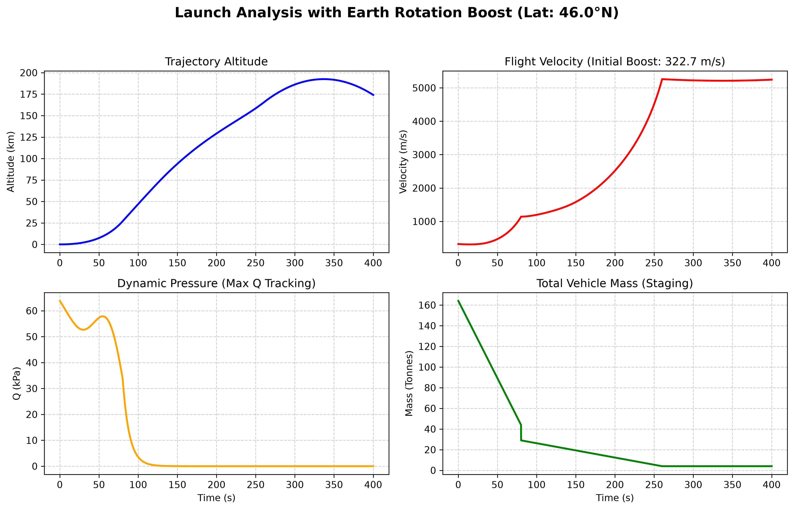

# 🚀 Advanced Two-Stage Launch Vehicle Flight Dynamics Simulator

[](https://www.python.org/)
[](https://numpy.org/)
[](https://matplotlib.org/)
[](LICENSE)

A high-precision, multi-stage rocket trajectory and flight dynamics simulation tool developed in Python. This project models the complete ascent phase of a launch vehicle from lift-off to Low Earth Orbit (LEO) insertion, incorporating real-world physical phenomena such as atmospheric density decay, Earth's rotational velocity boost, gravity-turn steering, aerodynamic drag, and Max-Q dynamic pressure analysis.

---

## 🔬 Mathematical & Physical Modeling

The simulation solves the equations of motion ($F = ma$) dynamically across distinct flight regimes using numerical integration:

1. Multi-Stage Mass Dynamics: Implements variable mass flow rates ($\dot{m}$) based on the Tsiolkovsky rocket equation, handling stage separation, structural dry mass, propellant depletion, and payload mass.
2. Earth Rotation Boost: Calculates the initial horizontal velocity boost ($\mathbf{V}_{\text{earth}}$) derived from Earth's angular velocity and the launch site latitude (modeled after the Baikonur Cosmodrome at $46^\circ\text{N}$).
3. Atmospheric Density Decay: Utilizes an exponential barometric formula for altitude-dependent air density ($\rho(y)$):
   $$\rho(y) = \rho_0 \cdot e^{-y / H}$$
4. Dynamic Pressure (Max-Q Analysis): Computes aerodynamic loading in real-time ($Q = \frac{1}{2}\rho v^2$) to track structural stress thresholds during atmospheric ascent.
5. Gravity Turn Trajectory: Implements a programmed pitchover maneuver transitioning from vertical lift-off to horizontal orbital insertion.

---

## 📊 Simulation Flight Analysis Dashboard

The automated multi-panel diagnostic dashboard generates comprehensive visual insights into the vehicle's performance:



* Trajectory Altitude: Tracks vertical displacement profile from pad to upper atmosphere.
* Flight Velocity: Monitors total velocity increments, staging velocity jumps, and orbital insertion speed.
* Dynamic Pressure ($Q$): Identifies the critical Max-Q peak where aerodynamic stress is maximized.
* Vehicle Mass Decay: Visualizes step-changes in total mass during stage separation events.

---

## 🛠️ Project Structure

`text
Two-Stage-Rocket-Simulation/
│
├── rocket_simulation.py                   # Main simulation script (Numerical solver & plotting)
├── launch_vehicle_dashboard_rotated.png # Generated high-res analytical dashboard
└── README.md                          # Project documentation


⚡ Quick Start & Installation
Ensure you have Python installed, then clone the repository and run the simulation locally:


```bash
# Clone the repository
git clone https://github.com/saif-ali-obayes/Two-Stage-Rocket-Simulation.git

# Navigate to the project directory
cd Two-Stage-Rocket-Simulation

# Install required scientific packages
pip install numpy matplotlib

# Execute the simulation script
python rocket_simulation.py

```

🎯 Future Roadmap
[ ] Integration of 3D Coriolis acceleration vectors and spherical Earth gravity models.
[ ] Implementation of aerodynamic heating and skin-temperature estimation models during Max-Q.
[ ] Monte Carlo simulation for wind shear and atmospheric turbulence disturbances.